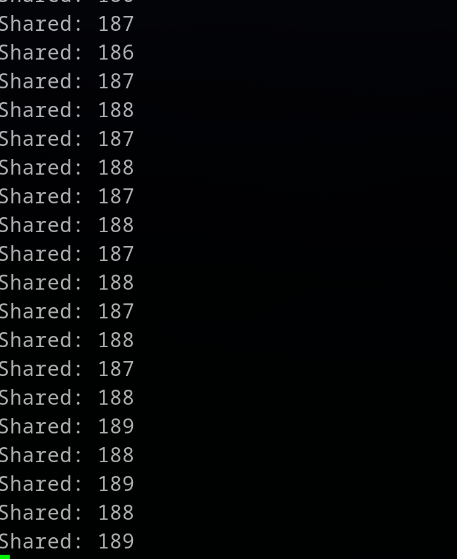
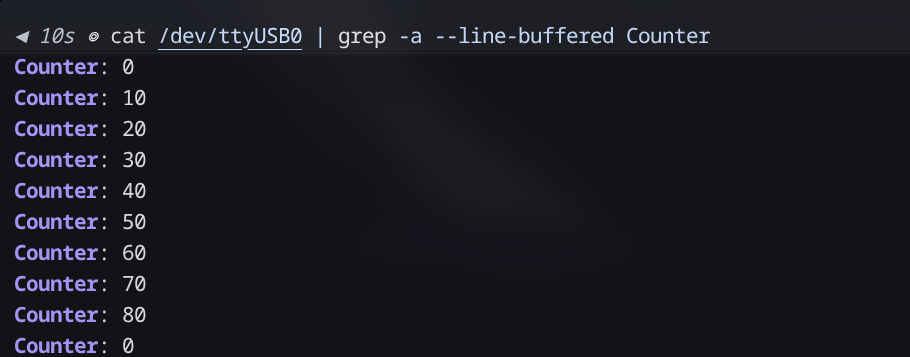
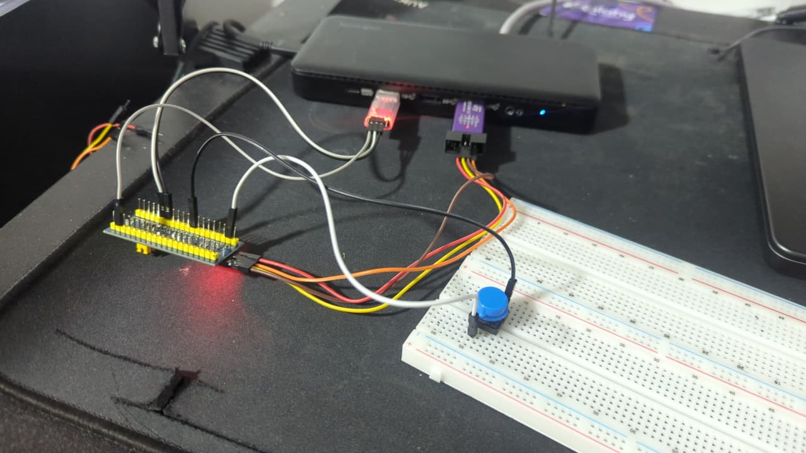

# FSUK27 Low Voltage – RTOS Task

FreeRTOS task for the ASURT FSUK27 Low Voltage learning phase, running on an STM32F103C8 (Blue Pill).

**FreeRTOS was added to the project by hand** (kernel V10.6.2, native API), not through CubeMX's FREERTOS middleware, so there is no CMSIS-RTOS layer. The earlier CMSIS version is kept on the `cmsis-version` branch.

**All my code is in [`Core/Src/main.c`](Core/Src/main.c)**, inside the `USER CODE` blocks. The rest of `Core/` and `Drivers/` is generated by STM32CubeMX.
Every HAL call has a UM1850 page reference, and every FreeRTOS call has a link to its freertos.org API page, in a `// REF:` comment above it.

## What it does

| Task | Runs | Does |
|---|---|---|
| **IncreaseVar** | every 10 ticks | `shared++`, wraps 200 → 100, sends it to the `UARTData` queue |
| **DecreaseVar** | every 12 ticks | `shared--`, wraps 100 → 200 (below 100 resets), sends it to the queue |
| **CalcSwitch1** | blocks up to 2 ticks on the event group | when the button event is set: reads `counter`, sends `counter × 10` (original not modified) |
| **UartTask** | every 5 ticks | empties the queue and prints each item as `Shared: N` or `Counter: N` |
| **Button ISR** (`HAL_GPIO_EXTI_Callback`) | on each press | `counter++` (reset to 0 when it reaches 9), sets the event bit with `xEventGroupSetBitsFromISR()` |

All four tasks are created with `xTaskCreate` at the same priority (`tskIDLE_PRIORITY + 1`). Tick = 1 ms.

## How FreeRTOS is added (without CubeMX)

- **Kernel source:** [`FreeRTOS/Kernel`](FreeRTOS/Kernel), FreeRTOS-Kernel **V10.6.2** from GitHub. Compiled files (listed in `CMakeLists.txt`): `tasks.c`, `queue.c`, `list.c`, `timers.c`, `event_groups.c`, the Cortex-M3 port `portable/GCC/ARM_CM3/port.c`, and the allocator `portable/MemMang/heap_4.c`.
- **Config:** [`FreeRTOS/FreeRTOSConfig.h`](FreeRTOS/FreeRTOSConfig.h). It is kept outside `Core/` so CubeMX never deletes it. Key settings: 1 ms tick, 8 KB heap, dynamic allocation only (`configSUPPORT_STATIC_ALLOCATION 0`), `configMAX_SYSCALL_INTERRUPT_PRIORITY` = 5, timers enabled (needed by `xEventGroupSetBitsFromISR`).
- **Interrupt handlers:** the port's handlers are mapped to the CPU's vector names in the config:
  `vPortSVCHandler → SVC_Handler`, `xPortPendSVHandler → PendSV_Handler`, `xPortSysTickHandler → SysTick_Handler`.
  In CubeMX (NVIC → Code generation) "Generate IRQ handler" is **unticked** for SVC, PendSV and SysTick, so they aren't defined twice.
- **HAL timebase:** TIM4, so SysTick belongs to FreeRTOS only.
- **EXTI4 (button) priority = 5.** The ISR calls `...FromISR` functions, which are only allowed at priority ≥ `configMAX_SYSCALL_INTERRUPT_PRIORITY`. At CubeMX's default of 0, FreeRTOS's `configASSERT` stops the system on the first press.

## Design decisions

- **Queue item:** a struct `uart_msg_t { source_t source; uint8_t value; }`. The enum `source_t` (`SRC_SHARED` / `SRC_COUNTER`) tells the UART task which label to print. Only the UART task formats text.
- **`shared` is protected by a mutex** (`xSemaphoreCreateMutex`). Each task takes it, changes and checks `shared`, copies the value into its message, gives it back, and only then sends to the queue. The mutex is never held while waiting on the queue.
- **Periodic timing uses `vTaskDelayUntil`.** It wakes relative to the last wake-up, so the period doesn't drift.
- **Queue send timeout = 5 ticks.** The UART task empties the queue every 5 ticks, so there is room soon. The timeout is not infinite, so a stuck UART task can't freeze the others.
- **`counter` is `volatile`**, because the ISR changes it. CalcSwitch1 reads it once into a local copy.
- **"Reset the counter to 0 when it reaches 9"** is read as: the counter goes 0…8, so the values sent are 0…80.
- **Debounce:** the ISR ignores presses within 50 ticks of the last accepted one. It uses `now - lastPress`, which stays correct when the 32-bit tick count wraps.
- **Every create is checked** (`NULL` / `pdPASS`) and goes to `Error_Handler()` on failure. The UART task gets a 256-word stack for `snprintf`, and the others get 128 words.

## Hardware

| Connection | Pins |
|---|---|
| USB-TTL adapter → board | TXD → PA10 (USART1 RX), RXD → PA9 (USART1 TX), GND → GND |
| Button | PB4 → GND (internal pull-up, falling-edge interrupt, NVIC priority 5) |
| ST-Link V2 | SWDIO, SWCLK, GND, 3.3V (powers the board) |

UART: 115200 baud, 8N1. Clock: 72 MHz (8 MHz HSE, PLL ×9).

## Output

`shared` drifts slowly upward (6 increments vs 5 decrements per 60 ticks):



Counter on button presses (one line per press after debouncing, wraps 80 → 0):



Setup:



## Build and flash

Generated with STM32CubeMX 6.18 (Toolchain: CMake), built with `arm-none-eabi-gcc`, flashed with OpenOCD and an ST-Link:

```sh
cmake --preset Debug
cmake --build --preset Debug
openocd -f interface/stlink.cfg -f target/stm32f1x.cfg \
  -c "program build/Debug/rtos-task.elf verify reset exit"
```

Serial monitor: PuTTY (Serial, `/dev/ttyUSB0`, 115200) or `picocom -b 115200 /dev/ttyUSB0`.
